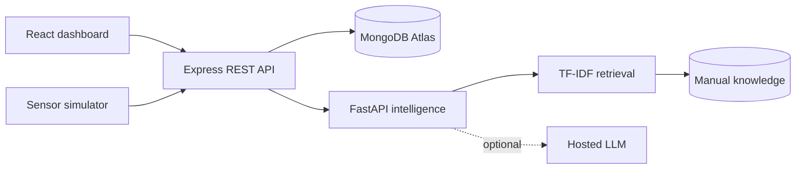

# MaintAI architecture

## Responsibilities

- React renders live telemetry, analytics, alerts, work orders and AI answers.
- Express owns authentication, authorization, validation and operational workflows.
- FastAPI owns anomaly scoring and evidence retrieval.
- MongoDB persists operational data when configured. The in-memory store keeps the portfolio demo runnable with no cloud account.
- The simulator replaces physical sensors and produces realistic temperature, vibration, pressure, power and RPM values.

## Security controls

- JWT sessions with expiry.
- Role checks for write operations.
- Zod request validation.
- Helmet response headers and disabled `x-powered-by`.
- CORS allowlist and JSON body limits.
- Authentication rate limiting.
- No secrets committed to the repository.
- AI recommendations explicitly require human verification.
